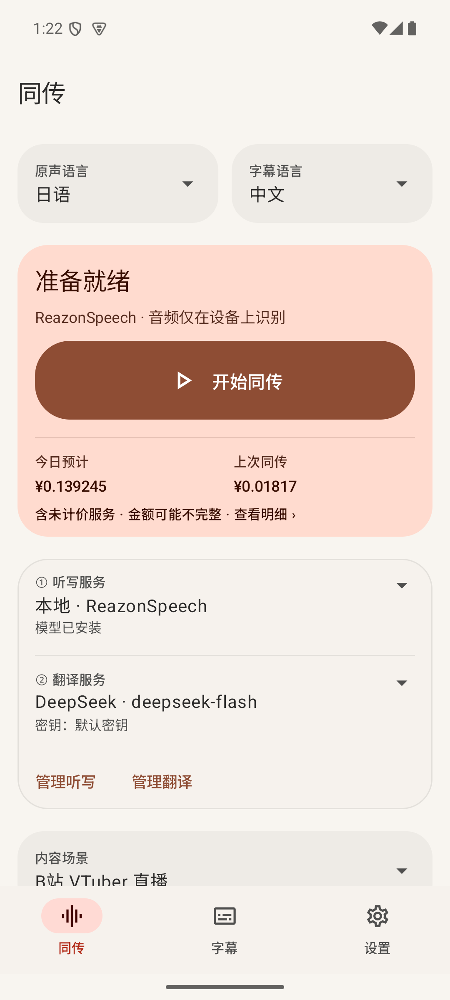
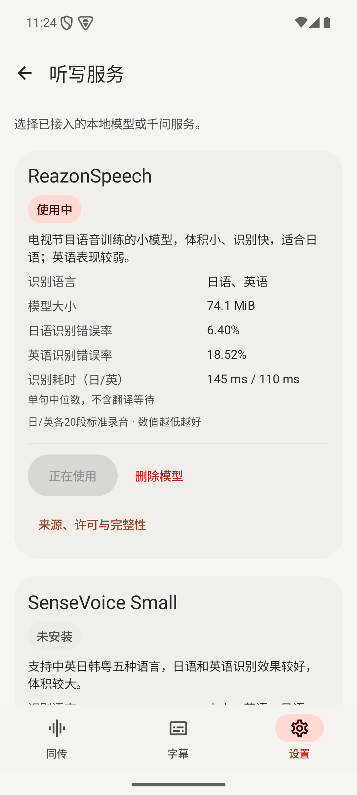
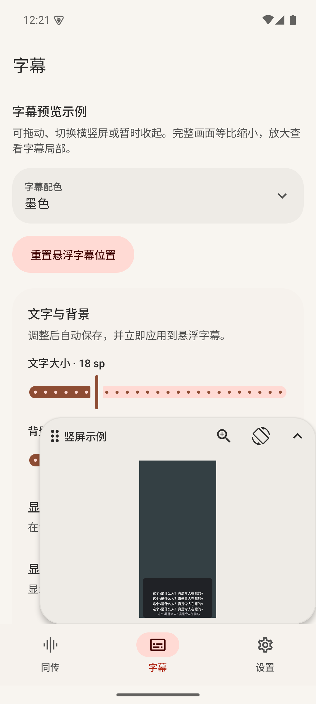
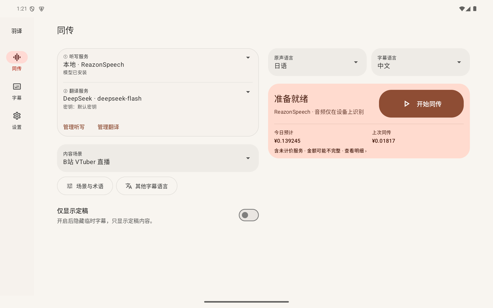

# 羽译 · Yuyi

Yuyi provides **floating translated subtitles for live streams and videos on Android**. Choose local recognition with your text translation API, direct cloud speech translation with Qwen LiveTranslate, or Qwen cloud transcription followed by your text translation API.

The current development version is **1.9.0**; the features below include new models and cloud listening. The first published stable release is **1.8.4**.

[Download release](https://github.com/ZOUYIQAQ/yuyi/releases/latest) · [Quick start](#quick-start) · [Documentation (Chinese)](docs/README.md) · [简体中文](README.md)

**Android only**: supports **Android 10+ phones and tablets with arm64-v8a**. Local recognition models are downloaded after installation and are not bundled in the APK. Cloud listening requires no local model.

## Download

Open the [latest release](https://github.com/ZOUYIQAQ/yuyi/releases/latest), download `yuyi-v1.8.4-android-arm64-v8a.apk` or the APK for a later version, and install it directly. Each release includes a `SHA256SUMS.txt` checksum file.

Actions builds and earlier local test builds use a different signing certificate and cannot be updated directly to the official release. Keep any configuration and records you need before uninstalling the test build yourself and installing the release. Uninstalling removes local configuration, downloaded models, and records. Future official releases will use the same signing certificate.

## Screens

| Live | Listening services | Subtitle style preview |
|---|---|---|
|  |  |  |

Tablet live view

## Core experience

- **Read subtitles while watching**: show translations over a live stream or video, with optional source text. Tap subtitles to reveal controls, then move, resize or lock the overlay.
- **Three listening modes**: choose from five local recognition models with your OpenAI-compatible translation API, or send playback audio directly to Qwen LiveTranslate. Alternatively, combine Qwen 3.1 Streaming transcription with DeepSeek or another text translation API. Saved configurations remain independent and all settings stay visible.
- **Adjust subtitles to suit your viewing**: translations only by default, keeping the latest 3 finalized sentences. Change font size, colors, opacity and subtitle window size, compare color schemes directly in the menu, and fine-tune them with a draggable floating preview.
- **Phone and tablet layouts**: a warm Camellia theme by default, with light/dark modes, custom colors and Android 12+ dynamic colors.

Add stream background and preferred translations under **设置 → 场景与术语 (Settings → Scenes and terms)**. Usage recording is off by default and can be enabled when needed.

## Quick start

First launch guides you through permissions and service selection. Built-in entries already contain their provider endpoint and model. Choose them directly from the two home menus after entering provider keys or downloading a local model. Every guide step can be skipped.

1. **Prepare a listening service**: local ReazonSpeech, SenseVoice, Whisper and Moonshine models are listed by default. Download and activate the chosen model in **Settings → Listening services**. For Qwen transcription or direct speech translation, enter the shared Qwen key in **Settings → Platform keys**.
2. **Prepare text translation**: DeepSeek and Qwen text models are preset. Enter the corresponding provider key, then choose the model in the home translation menu. Direct speech translation already includes translation and needs no second service.
3. **Start**: choose source and target languages and an optional scene, tap Start, and confirm the system playback-capture permission.

The existing service lists remain available under Settings for editing endpoints and models, testing connectivity, or adding a custom compatible interface. Normal use does not require creating or naming a service. Scenes and terminology remain separate. See [cloud setup](docs/online-listening.md).

Credentials are managed under **Settings → Platform keys**. Each provider can store multiple named keys. Choose a key for each listening, translation, or auxiliary service; the home menus show the selected key name. Configure **transcription first, then text translation**; Qwen voice translation already returns translated captions and needs no separate text translation setup. DeepSeek presets use the tested full endpoint `https://api.deepseek.com/v1/chat/completions`.

Built-in provider and model connections appear under **设置 → 听写服务 (Listening services)** and **设置 → 翻译服务 (Translation services)** and appear in the home menus when ready to use. Downloads and model deletion belong to **设置 → 听写服务 (Listening services)**. Subtitle style and appearance are grouped under Personalization. Built-in cloud services offer a key-selection dialog; translation services retain connection settings and testing. Add a custom OpenAI-compatible connection or use one of 24 provider templates. Translation models can be selected from platform presets or entered manually; existing custom IDs remain editable. See [provider templates](docs/provider-templates.md).

### Which recognition model?

| Model | Source languages | Download size | Features |
|---|---|---|---|
| ReazonSpeech | Japanese, English | About 74.1 MiB | Smaller download for viewers mainly watching Japanese or English content who want to save storage |
| SenseVoice Small | Chinese, English, Japanese, Korean, Cantonese | About 229.1 MiB | Broader language coverage, with punctuation and normalized numbers in recognition results |
| Whisper Tiny multilingual | Chinese, English, Japanese, Korean | About 99.4 MiB | General multilingual recognition; speed depends on the device |
| Moonshine Tiny English | English | About 118.8 MiB | English-only recognition for short speech |
| Moonshine Tiny Japanese | Japanese | About 69.4 MiB | Smaller Japanese-only model |

All packages include the required voice activity detection model. Stop the session before switching recognition models.

## Usage and estimated cost

Choose a listening service first, then a saved text translation service. Qwen direct voice translation includes the second step. The home screen shows today and the previous session; Settings → Usage and cost shows the breakdown. Timestamped numerical usage and rate snapshots are retained locally for future hourly or custom-range statistics, independently of subtitle logging. No audio, subtitle text or credentials are stored in the cost ledger. Unknown usage or rates are marked as unpriced rather than free. Figures are estimates, not supplier bills.

## FAQ and links

**Is audio uploaded?** Local mode sends recognized text to your configured translation API, while cloud mode sends playback audio to the selected speech translation service. Neither mode saves raw audio. You can also connect to a compatible translation endpoint hosted on your device or local network. See [Translation configuration](docs/translation.md).

**Why do some videos produce no subtitles?** The source app, protected content and system playback-capture restrictions can prevent capture. Other apps playing capturable audio at the same time may also be recognized; pause unrelated audio during use.

**Does it save viewing records?** Session recording is off by default, and raw audio is not saved. Enable text records explicitly under **设置 → 使用记录 (Settings → Usage records)**. See [Usage records](docs/logs.md) and [Privacy](docs/privacy.md).

See the [documentation index](docs/README.md) for more information, or the [build guide](docs/build.md) to build the app yourself. These documents are in Chinese.

## Fork and acknowledgements

Yuyi is based on [simul-subtitle](https://github.com/KorenKrita/simul-subtitle) by **KorenKrita**. This fork is maintained by **ZOUYIQAQ** and can be installed alongside the original, with separate data and permissions.

Application code is licensed under [MIT](LICENSE), retaining the original author's copyright notice. Thanks to [sherpa-onnx](https://github.com/k2-fsa/sherpa-onnx), [ReazonSpeech](https://github.com/reazon-research/ReazonSpeech), [SenseVoice](https://github.com/FunAudioLLM/SenseVoice) and [Silero VAD](https://github.com/snakers4/silero-vad). Models and dependencies retain their own licenses; see [Model sources and licenses](docs/MODEL_SOURCES.md).
