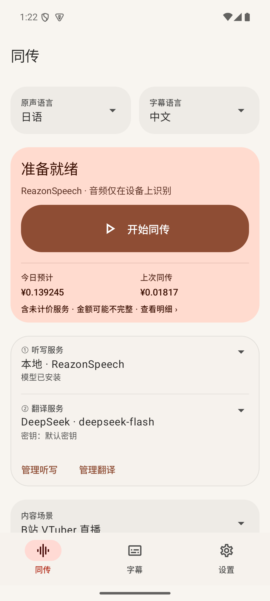
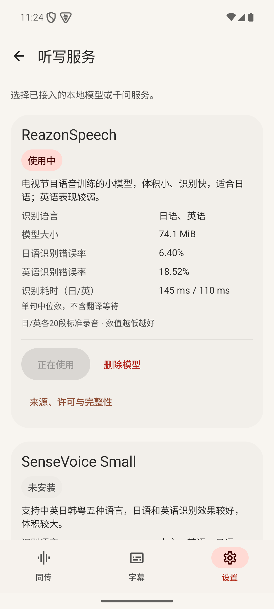
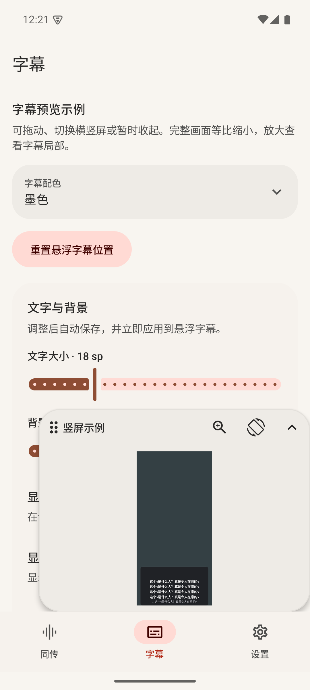
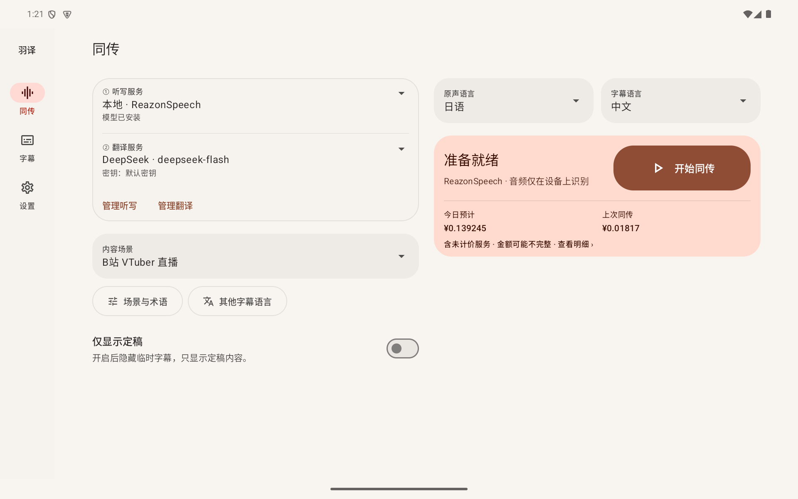

# 羽译 · Yuyi

羽译是面向 **Android 直播与视频的悬浮听译字幕工具**：先选择听写服务，再选择翻译服务；支持本地识别、在线听写和语音直译，将译文显示在其他应用上方。

当前开发版本为 **1.9.0**，下文包含新增模型与在线模式；已发布的首个正式版为 **1.8.4**。

[下载正式版](https://github.com/ZOUYIQAQ/yuyi/releases/latest) · [快速上手](#快速上手) · [使用文档](docs/README.md) · [English](README.en.md)

仅支持 **Android 10 及以上、arm64-v8a 手机和平板**。APK 不内置识别模型。本地模式安装后选择下载；在线模式无需下载模型。

## 下载

进入 [最新正式版](https://github.com/ZOUYIQAQ/yuyi/releases/latest)，下载 `yuyi-v1.8.4-android-arm64-v8a.apk` 或后续版本对应的 APK，直接安装即可。每个版本同时提供 `SHA256SUMS.txt` 校验文件。

如果此前安装的是 Actions 或本地测试包，因正式版签名不同，无法直接覆盖安装。请先保留需要的配置和记录，再自行卸载测试版并安装正式版。卸载会清除本地配置、已下载模型和记录；后续正式版使用同一签名更新。

## 界面

| 同传 | 听写服务 | 字幕样式预览 |
|---|---|---|
|  |  |  |

平板同传界面

## 核心体验

- **边看边读字幕**：在直播或视频上方显示译文，也可开启原文。点按字幕展开工具栏，拖动调整位置、缩放或锁定。
- **听写、翻译分两步**：本地模式提供五种识别模型，配合自选 OpenAI 兼容文字翻译 API；在线模式接入千问 LiveTranslate，音频直接交给云端听译；还可用千问在线听写＋DeepSeek 等文字翻译服务，降低长时间观看成本，延迟可能更高。
- **按观看习惯调整字幕**：默认只显示译文，保留最近 3 句定稿；可调整字号、配色、透明度和字幕框大小，配色列表直接展示各套字幕效果，也可通过可拖动的浮动预览调整细节。
- **用量与费用**：首页查看今天和上次同传的预计费用，设置中查看分类。用量明细长期保存在设备上，独立于字幕记录；未回报用量或缺少单价的服务会标为未计价。
- **手机和平板适配**：默认采用「山茶」暖色外观，支持深浅色、自定义配色，以及 Android 12 及以上的动态颜色。

设置入口始终保留全部本地与在线配置，切换模式不会隐藏另一种方式的设置。

还可在「设置 → 场景与术语」补充直播背景与固定译名。使用记录默认关闭，需要时再主动开启。

## 快速上手

首次打开先授权，再从两款基础本地模型或三项千问服务中选择听写方式并配置翻译。通知权限可选。选择千问后再填写密钥，本地模型选择后再下载。各步都可跳过，稍后在设置中补齐。平台密钥在「设置 → 平台密钥」集中保存，同一平台可添加多份带名称的密钥，也能在服务内快捷添加；可指定其中一把为默认，跟随默认的服务自动使用它。

1. **授权**：按引导允许录音和悬浮显示；每次开始同传时，确认系统的屏幕共享／音频采集授权。
2. **选择听写服务**：软件提供本地识别模型、千问在线听写、实时听译和分段听译，准备好后出现在首页下拉。使用本地模型时，到「设置 → 听写服务」下载并启用；使用千问时，可在服务页直接填写百炼密钥。
3. **选择翻译服务**：首页预置 DeepSeek 与千问文字翻译模型，在平台密钥页填入对应密钥即可选用。选择语音直译时已经包含翻译，无需再配第二步。
4. **开始听译**：在首页的两个下拉框选择基础服务，再选择原声语言、字幕语言和内容场景，点击「开始同传」，按系统提示授权后切换到直播或视频。

「设置 → 听写服务／翻译服务」保留完整服务目录。内置云服务通过小弹窗选择密钥，翻译服务可继续进入连接设置与测试；本地模型在听写服务管理。常规使用无需创建服务或填写服务名称，支持添加自定义兼容接口，已有配置继续保留，场景与术语单独管理。
翻译服务提供 **24 项国内外供应商模板**，模型可从平台预设中选择，也可直接手填；支持任意 OpenAI 兼容接口，详见[供应商模板](docs/provider-templates.md)。

首页下拉只显示已下载模型和已配好密钥的内置服务，并标明所用密钥名称。模型简介、下载、选择和删除在「听写服务」统一管理；字幕样式与外观统一放在设置的「个性化」分组。

### 选哪个识别模型？

| 模型 | 原声语言 | 下载大小 | 特点 |
|---|---|---|---|
| ReazonSpeech | 日语、英语 | 约 74.1 MiB | 体积较小，适合以日英内容为主、希望少占存储空间的用户 |
| SenseVoice Small | 中文、英语、日语、韩语、粤语 | 约 229.1 MiB | 语言覆盖更多，识别结果带标点与数字规整 |
| Whisper Tiny 多语种 | 中文、英语、日语、韩语 | 约 99.4 MiB | 多语种通用识别，支持标点；连续直播需按设备速度实测 |
| Moonshine Tiny 英语 | 英语 | 约 118.8 MiB | 英语专用，面向短语音识别 |
| Moonshine Tiny 日语 | 日语 | 约 69.4 MiB | 日语专用，小体积，适合优先尝试日语内容 |

各下载包均包含所需的静音检测模型。切换模型前请先停止同传。

## 常见问题与入口

**声音会上传吗？** 本地模式只发送识别文字给你配置的文字翻译 API；在线模式会把播放音频发送给所选听译服务。在线听写模式将音频交给听写服务，再将识别文字交给文字翻译服务。三种模式均不保存原始音频。也可连接自己在本机或局域网提供的兼容翻译接口，详见[翻译配置](docs/translation.md)。

**为什么有些视频没有字幕？** 音源应用、受保护内容及系统的内录限制会影响采集；其他允许内录且同时播放的声音也可能被识别，使用时请暂停无关音源。

**会保存观看记录吗？** 默认不保存会话记录，也不保存原始音频。文字记录需在「设置 → 使用记录」主动开启，详见[使用记录](docs/logs.md)与[隐私说明](docs/privacy.md)。

更多说明见[文档目录](docs/README.md)；自行构建见[构建文档](docs/build.md)。

## Fork 与致谢

羽译基于 **KorenKrita** 的 [simul-subtitle](https://github.com/KorenKrita/simul-subtitle)，本 Fork 由 **ZOUYIQAQ** 维护，可与原版同时安装，数据与权限独立。

应用代码采用 [MIT 许可](LICENSE)，保留原作者版权声明。感谢 [sherpa-onnx](https://github.com/k2-fsa/sherpa-onnx)、[ReazonSpeech](https://github.com/reazon-research/ReazonSpeech)、[SenseVoice](https://github.com/FunAudioLLM/SenseVoice) 和 [Silero VAD](https://github.com/snakers4/silero-vad)；模型与依赖遵循各自许可，见[模型来源与许可](docs/MODEL_SOURCES.md)。
