# 同传字幕 · SimulSub

[English](README.en.md) · [技术文档](docs/README.md) · [项目与发行版](https://github.com/ZOUYIQAQ/simul-subtitle/releases)

在 Android 上识别正在播放的声音，通过你自己的翻译 API 显示悬浮字幕。语音识别与静音检测在设备本地运行，翻译服务接收文字。支持手机和平板；仓库只保留 Android 产品及其共享核心。

## 开始使用

需要 **Android 10（API 29）及以上、arm64-v8a** 设备。安装 APK 后：

1. 进入「模型库」，下载适合原声语言的模型包。每包已包含各自的 Silero VAD，无需另选；逐文件校验完成后，手动点击「启用模型」。
2. 进入「设置 → 翻译 API」，选择服务预设或手动填写地址、模型 ID 和自己的密钥，点击「保存翻译配置」。可点「测试连接」：它会先保存，再请求服务，可能计费。
3. 在「同传」页选择原声语言、目标语言与场景，按提示授予录音、悬浮窗和系统屏幕共享授权，点击「开始同传」。

音频采集受来源 App 的采集策略、DRM、系统版本及设备实现影响，不能保证所有播放器或内容都可采集。系统授权界面也可能因设备不同而不同；当前采集未按单个进程隔离，其他允许内录且同时发声的应用可能混入字幕。

## 界面

| 同传 | 模型库 | 翻译 API |
|---|---|---|
| 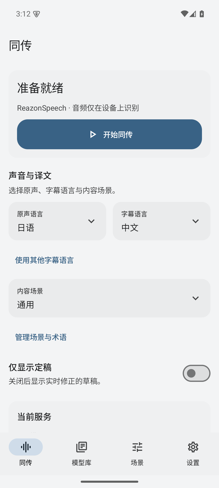 | 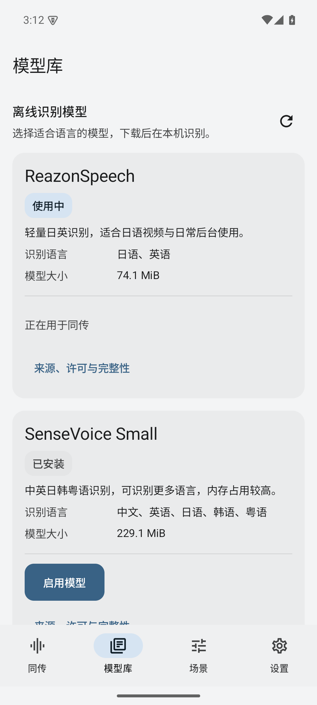 | 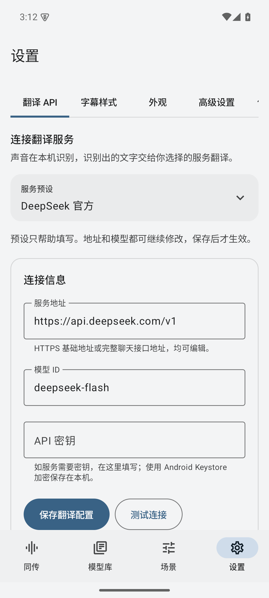 |

| 实际悬浮字幕 | 字幕设置预览 | 外观 |
|---|---|---|
| 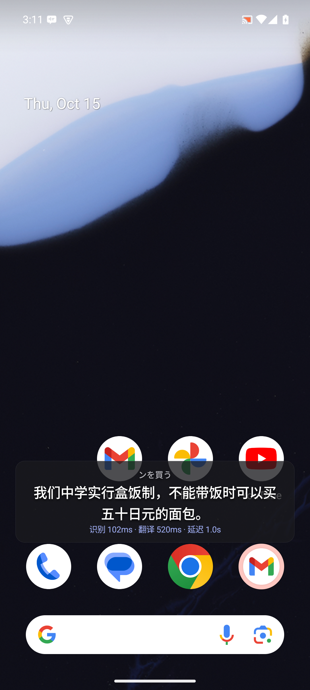 | 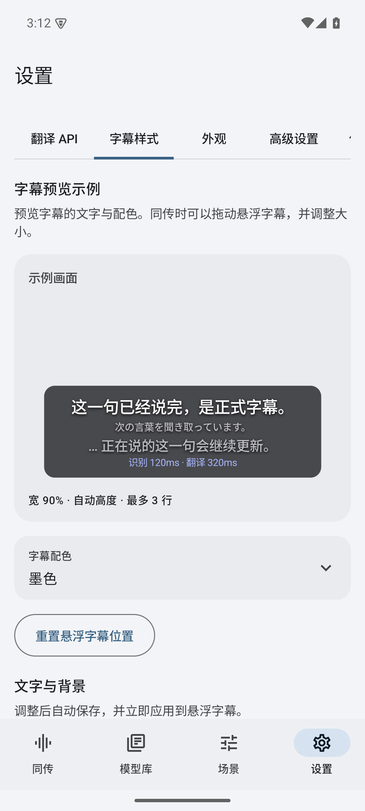 | 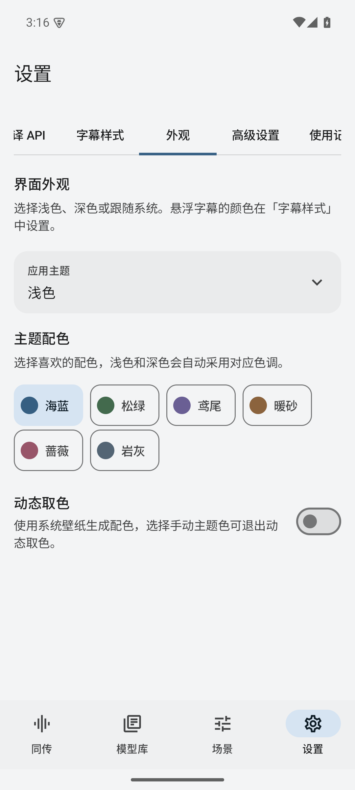 |

| 场景术语 | 深色界面 |
|---|---|
| 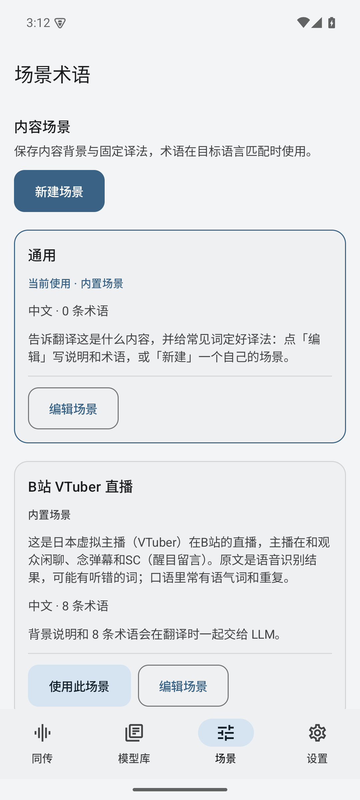 | 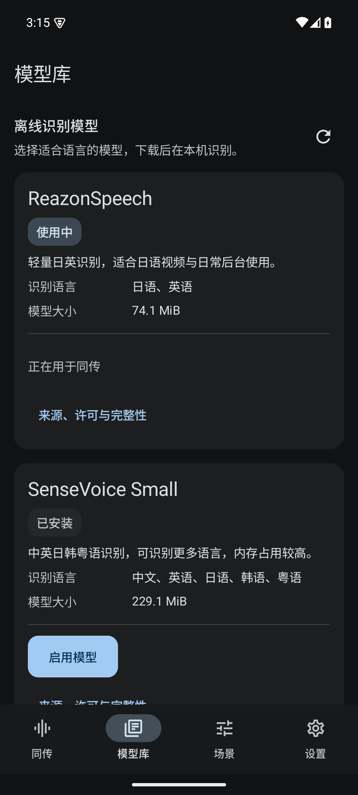 |

| 平板同传 | 平板模型库 | 平板设置 |
|---|---|---|
| 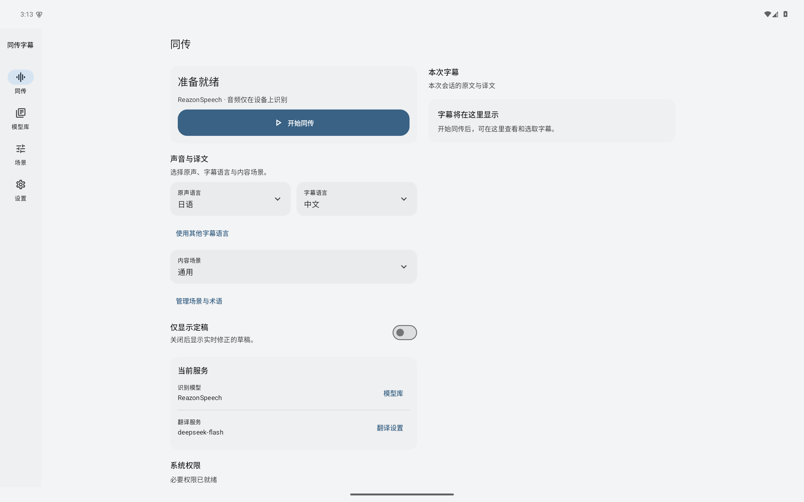 | 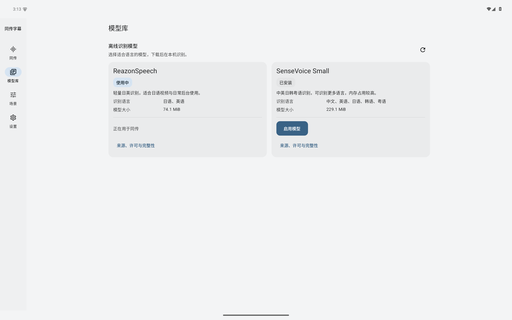 | 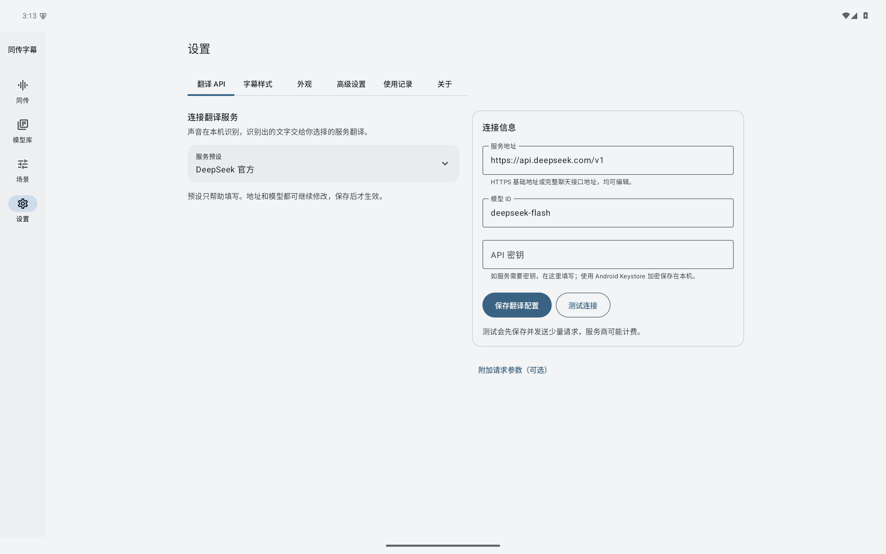 |

以上为2026-10-15本地API35模拟器的真实截图，平板图使用平板窗口尺寸；实际悬浮字幕图来自真实内录与离线识别，译文由本地固定响应夹具提供。

界面编排参考[FlClash](https://github.com/chen08209/FlClash)的Material You层级与卡片组织，使用原生Compose Material3实现。

窄屏为底部导航，宽屏为侧边导航；页面按可用宽度排布。字幕设置中的示例用于预览样式，实际浮窗见上方「实际悬浮字幕」。

## 模型与翻译

| 识别模型 | 原声语言 | 完整下载量（含 VAD） |
|---|---|---|
| ReazonSpeech | 日语、英语 | 77,745,395 字节，约 74.1 MiB |
| SenseVoice Small | 中文、英语、日语、韩语、粤语 | 240,193,589 字节，约 229.1 MiB |

APK 不内置 ASR 或 VAD 权重。模型下载到应用私有目录，校验字节数与 SHA-256 后才可手动启用；同传运行期间不能切换模型，需停止后切换。许可文本以 APK 的 `assets/licenses/` 随包提供，并非与模型下载到同一目录。详情见[模型说明](docs/asr.md)和[来源核查](docs/MODEL_SOURCES.md)。

翻译 API 提供 DeepSeek 官方、硅基流动、OpenRouter 预设，也支持自定义 OpenAI 兼容聊天接口。预设仅填写草稿，不保存、不请求网络，所有字段均可修改；跨端点切换预设会清空草稿里的旧密钥、自定义请求头和 User-Agent。OpenRouter 需要自行填写模型 ID。默认值与官方来源核查日期为 **2026-10-15**，服务商可随时调整；这不代表已验证你的付费账户或 API。详见[翻译配置](docs/translation.md)。

## 常用设置

- **同传**：选择原声、译文语言和场景，切换「仅显示定稿」。原声选项随已启用模型变化；目标语言也可自行填写。
- **场景术语**：独立导航入口，编辑背景、固定译名，或调用自己的翻译服务生成术语；生成后需检查并保存。
- **设置 → 字幕样式**：字幕配色、文字大小、背景不透明度、原文、耗时、宽高和旧句保留策略。最多显示行数可设 0（不限）或 1–20，按实际换行合计原文与译文，保留最新行；耗时和状态提示不计入。仍受屏高 40% 与固定高度约束，取更严格限制；不改变会话历史或提示词上下文。
- **设置 → 外观**：海蓝、松绿、鸢尾、暖砂、蔷薇、岩灰六色，Android 12 及以上可动态取色，旧系统回退所选配色。浅色、深色或跟随系统独立设置，应用外观与字幕配色分开。
- **设置 → 高级设置**：结合上文翻译、衔接重复字处理、Jev 智能断句与译文检查。Jev 默认关闭，开启后发送文字到第三方服务，可能计费或限速。
- **设置 → 使用记录**：默认关闭，可开启文字 JSONL 记录、分享、确认删除单条或确认清空。正在写入的记录受保护，不能分享或删除。

点按实际字幕可展开工具栏，拖动移动，展开后拖四角调整大小；支持锁定与停止。可在「字幕样式」重置位置。

## 更新与构建

「设置 → 关于 → 检查更新」只读取 [ZOUYIQAQ/simul-subtitle 的 latest release](https://api.github.com/repos/ZOUYIQAQ/simul-subtitle/releases/latest) 并显示发行标签；「打开项目仓库」打开项目页，由用户自行查看与下载。当前没有自动检查、应用内下载或安装、更新代理回退、跳过版本或关闭自动检查的开关。

自行构建见[构建与开发](docs/build.md)。当前构建入口为 `:core` 与 `:app`，不分发 macOS / Windows 版本。

## 更多说明

[架构](docs/architecture.md) · [ASR](docs/asr.md) · [翻译](docs/translation.md) · [Jev](docs/jev.md) · [隐私](docs/privacy.md) · [使用记录](docs/logs.md)

应用代码采用 [MIT License](LICENSE)。感谢 [sherpa-onnx](https://github.com/k2-fsa/sherpa-onnx)、[ReazonSpeech](https://github.com/reazon-research/ReazonSpeech)、[SenseVoice](https://github.com/FunAudioLLM/SenseVoice) 与 [Silero VAD](https://github.com/snakers4/silero-vad)。模型和依赖遵循各自许可；Jev 是可选的第三方云服务。
