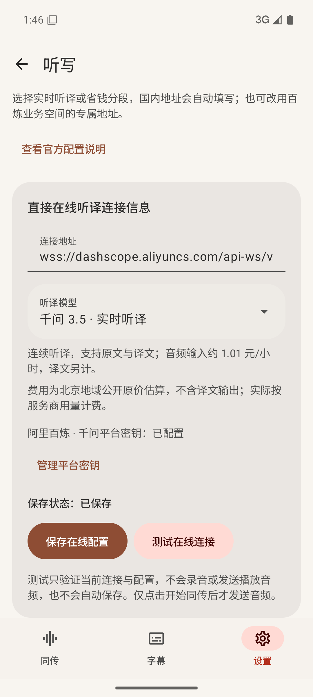

# 在线听译

在线听译把正在播放的音频直接交给千问 LiveTranslate，无需下载识别模型，也无需另配文字翻译 API。可选择连续实时听译，或费用较低的分段听译。

## 开始使用

1. 在首页或首次引导的听写下拉中选择预置的千问实时听译或分段听译模型。
2. 在「设置 → 平台密钥」填写百炼密钥即可使用，内置模型与地址已配好。需要更改业务空间地址时，再进入对应服务的编辑页。
3. 点击「测试在线连接」：实时版验证会话配置，分段版通过模型目录验证鉴权与可用模型；均不发送播放音频，也不自动保存。确认后点击「保存听写服务」。
4. 回到首页，在听写下拉选择已保存的服务，再选择原声和字幕语言，点击开始，按系统提示授权播放声音采集。

密钥保存后会回填，默认隐藏，可点击眼睛查看或修改。地址与密钥应属于同一百炼地域；使用业务空间专属地址时，请从控制台复制完整地址，替换示例中的业务空间 ID。默认公共国内域名仍受官方支持，见[千问接入说明](https://help.aliyun.com/zh/model-studio/qwen-livetranslate-java-sdk)。

查看在线听译配置界面

## 直接听译的模型选项

### 在线模型选择

| 模型 | 字幕方式 | 音频输入估算 | 文字输出单价 |
| --- | --- | --- | --- |
| 千问 3.5 · 实时听译 | 连续发送音频，同时返回原文与译文 | 约 1.01 元/小时 | 100 元/百万 Token |
| 千问 3 · 省钱分段 | 收集短段后上传，只返回译文；延迟稍高 | 约 0.45 元/小时 | 10 元/百万 Token |

价格核对日期为 2026-10-16，按北京地域公开原价和官方音频 Token 换算估算，未计文字输出、免费额度或优惠，实际以账单为准。来源：[模型价格](https://help.aliyun.com/zh/model-studio/model-pricing)、[分段版音频计费](https://help.aliyun.com/zh/model-studio/qwen3-livetranslate-flash)、[实时版音频计费](https://help.aliyun.com/zh/model-studio/qwen3-5-livetranslate-flash-realtime)。

省钱版在停顿处分段，连续讲话最长约 8 秒提交一段，后台不加载识别模型。每段独立翻译，不承诺与实时版有相同的跨段理解；纯静音不会持续上传。仍可调整原有字幕样式与临时字幕开关。运行期间停止会取消在途请求并丢弃尚未上传的片段，避免退出后继续计费。

### 处理方式

| | 本地识别 | 在线听译 |
| --- | --- | --- |
| 识别位置 | 手机或平板本地 | 所选云端服务 |
| 必要配置 | 识别模型、文字翻译 API | 千问听译地址、模型与密钥 |
| 上传内容 | 识别文字与翻译上下文 | 正在播放的音频 |
| 场景和固定译名 | 支持 | 当前不接入本地场景和术语 |
| 语言 | 随本地模型；译文可自定义 | 本次接入提供中、英、日、韩；原声可自动检测 |

可随时在首页或设置切换。运行中先停止同传再切换，其他模式的已保存配置和本地模型会保留。

下拉框仅列出实际接入的实时版与省钱分段版；已有的指定日期快照仍可回填。模型接口不同，不能通过任意填写名称接入其他模型。费用由服务商收取，不会自动重连或后台发送音频。字幕样式、预留临时字幕空间、贴底和动画规则与本地模式相同。

已确认的译文会逐句显示，无需等待整段说完；尚在修正的尾部继续显示为临时小字幕。较长分句会适当拆开，最终文字校正保留原位置，避免整段突然出现或重复追加。开启「仅显示定稿」后，只显示已确认的短句。

## 在线听写＋文字翻译

第三种方式由千问 `qwen-audio-3.1-asr-flash-streaming` 识别播放音频，再由 DeepSeek 或已配置的文字翻译 API 生成译文。无需安装本地模型，适合希望降低长时间听译成本、愿意接受额外翻译等待的用户。

1. 在首页听写下拉中选择预置的千问 3.1 Streaming 在线听写模型。
2. 在「平台密钥」填写百炼密钥，默认模型与地址已预置，无需新建。
3. 在「平台密钥」填写 DeepSeek 或千问密钥，再到首页翻译下拉选择预置的对应模型。也可在翻译服务页编辑地址和模型，或添加自定义兼容接口。
4. 首页选择原声、字幕语言和内容场景，开始同传。场景背景和术语原文同时帮助听写理解，固定译名继续用于文字翻译。

只有听写定稿进入文字翻译，不会为反复变化的听写草稿重复调用翻译；翻译保留句意后再拆为短字幕，句末标点不显示。网络处理跟不上时会明确停止，不无限积压或静默丢弃音频。停止同传会取消听写连接及文字翻译请求。

配置按听写与翻译分为两步。选择语音直译时不需要另配翻译。听写与直接听译的地址、型号分别保留，千问密钥共用一份；DeepSeek 等文字翻译服务也按平台共用密钥，切换模型无需重复填写。设置中始终保留全部配置入口，不会随当前模式隐藏本地模型或其他服务。

3.1 Streaming 使用音频输入与文字输出 Token 计费，不能套用旧型号的固定每小时报价；还需加上文字翻译费用。价格和能力见[千问 3.1 Streaming 官方模型页](https://help.aliyun.com/zh/model-studio/qwen-audio-3-1-asr-flash-streaming)。实际总费用取决于讲话密度、上下文和输出长度，以各服务账单为准。

## 平台密钥

「设置 → 平台密钥」统一保存千问、DeepSeek、硅基流动、OpenRouter、TypeSafe 和已配置的自定义服务凭据。密钥可直接输入或粘贴，保存后仍可通过眼睛按钮查看和修改。千问官方听写与语音直译共用一份；切换模型无需再次填写。

自定义地址使用独立的来源密钥，不会自动收到官方平台的凭据。修改地址后，在「管理平台密钥」配置对应来源即可。已保存的自定义平台即使暂时没有使用，也会保留在密钥页。

## 两步选择与费用

首页和首次引导先选择听写服务，再选择已保存的翻译服务。选择千问实时听译或分段直译时，第二步显示「已包含翻译」，不用配置文字接口。首页下拉只列服务，创建和编辑在设置的服务列表中完成，平台密钥各填一次。模型文件统一在「设置 → 听写服务」下载和管理；字幕样式与外观在「个性化」分组。

首页可查看今天、上次同传和运行中本次的预计费用；「设置 → 用量与费用」展示分类。费用独立于字幕保存开关，长期保留带时间的用量明细和计价快照，可用于后续按小时或任意时段统计。服务商重复回报累计用量不会重复计费。未知单价、取消或服务未回报的用量标为未完整计价。

计价使用真实接口用量和内置参考单价；优惠、赠送额度和账单调整不在客户端估算内。DeepSeek 按北京时间工作日时段区分峰谷，当前未识别中国法定节假日，假日工作时段可能高估。费率来源：[阿里百炼](https://help.aliyun.com/zh/model-studio/model-pricing)、[DeepSeek](https://api-docs.deepseek.com/zh-cn/quick_start/pricing/)。

服务内的「填写／添加密钥」会打开小弹窗，保存后即可使用，连接草稿和页面位置保留。在平台密钥页可以将任意已保存密钥设为默认；跟随默认的服务同步切换，明确绑定某把密钥的服务保持不变。
